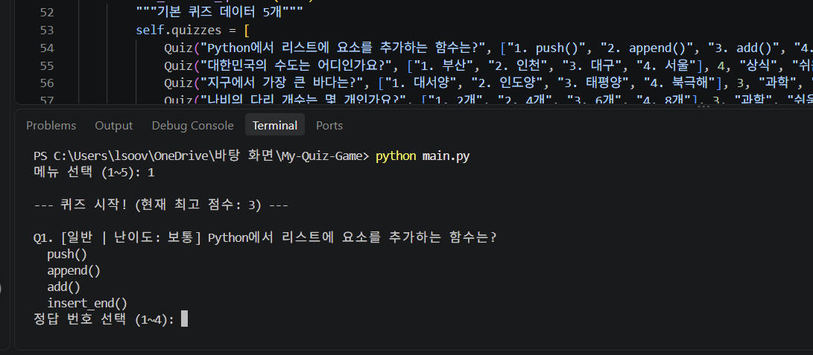
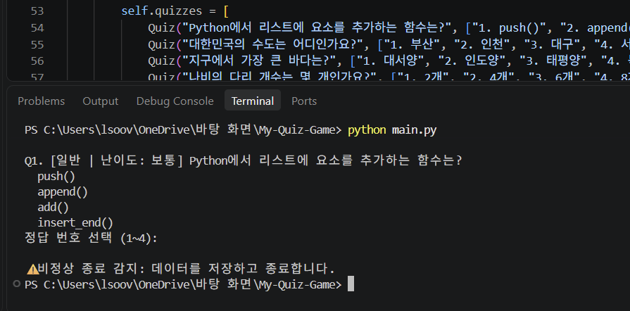
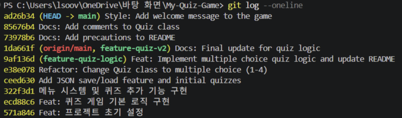
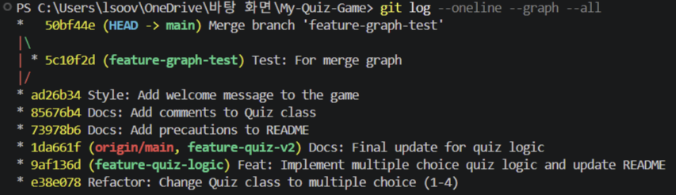
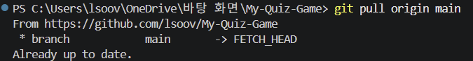

# 퀴즈 게임 프로젝트 (Quiz Game)
이 프로젝트는 파이썬을 이용한 객체지향 퀴즈 게임 프로그램입니다. 데이터 영속성을 위해 JSON 파일을 활용하며, 안정적인 입력 검증과 백업 시스템을 갖추고 있습니다.

## 1. 실행 방법 및 실습 가이드
이 프로젝트를 로컬 환경에 복제하고 실행하는 방법입니다.

```powershell
# 1. 저장소 복제 (Clone)
git clone https://github.com/lsoov/My-Quiz-Game

# 2. 저장소 업데이트 (Pull)
git pull origin main

# 3. 프로그램 실행
python main.py
``` 

## 2. 클래스 설계 및 역할
본 프로그램은 유지보수와 확장성을 위해 두 개의 주요 클래스로 구성되었습니다.

Quiz 클래스: 개별 퀴즈의 데이터를 관리합니다. 문제 내용, 보기, 정답, 카테고리, 난이도 정보를 하나의 객체로 캡슐화합니다.

QuizGame 클래스: 게임의 전체 흐름을 제어합니다. 메뉴 출력, 퀴즈 실행, 점수 계산, 데이터 입출력(I/O) 등 게임의 비즈니스 로직을 담당합니다.
💡 클래스 사용 이유 (객체지향의 이점):
단순 함수형 프로그래밍에 비해, 클래스를 사용하면 문제 데이터(Quiz)와 게임 기능(QuizGame)이 논리적으로 분리됩니다. 덕분에 코드 재사용성이 높아지고, 새로운 속성(예: 힌트, 타이머)을 추가할 때 기존 코드를 최소한으로 수정하며 확장할 수 있습니다.

## 3. 로직 분리 기준
UI와 로직의 분리: 사용자에게 메시지를 보여주고 입력받는 부분과 실제 정답을 판별하고 점수를 계산하는 로직을 분리하여 구현했습니다.

입력 검증 분리: get_safe_input 메서드를 통해 모든 숫자 입력을 통합 관리합니다. 이를 통해 잘못된 입력(문자열 입력, 범위 초과 등)으로 인한 프로그램 강제 종료를 방지합니다.
기준: "사용자로부터 받는 모든 입력은 신뢰할 수 없다"는 원칙하에, 정수 변환 예외 처리와 범위 체크 로직을 별도 메서드로 독립시켰습니다.
## 4. 데이터 저장 방식 (JSON)
JSON 채택 이유: 텍스트 기반의 데이터 포맷으로 가독성이 높고, 파이썬의 딕셔너리 구조와 1:1 메핑되어 데이터를 저장하기에 최적입니다.

필드 설계 및 중첩 구조 이유:
high_score: 사용자의 최고 기록을 단일 값으로 관리.

quizzes: 여러 개의 Quiz 객체를 리스트로 묶은 중첩 구조.

이유: 연관된 데이터를 하나의 JSON 파일 안에서 계층적으로 관리함으로써, 데이터 로드 한 번으로 게임에 필요한 모든 상태를 복원할 수 있습니다.

읽기/쓰기 흐름:
읽기: os.path.exists로 파일 확인 → json.load로 파싱 → Quiz 객체 리스트로 초기화.
쓰기: 데이터 딕셔너리화 → shutil.copy로 백업 생성 → json.dump로 파일 쓰기.
한계 및 대안: JSON은 수정 시 파일 전체를 다시 써야 하므로 데이터가 수만 개 이상으로 커지면 성능(I/O 병목)과 메모리 문제가 발생합니다. 이 경우 SQLite 같은 **관계형 데이터베이스(RDBMS)**를 사용하는 것이 효율적입니다.

## 5. 예외 처리 및 데이터 복구
비정상 종료 대응: KeyboardInterrupt(Ctrl+C) 발생 시 try-except 문을 통해 종료 직전 save_data()를 강제 호출하여 데이터 유실을 방지합니다.

저장/로드 예외 처리: 파일 쓰기 권한 오류나 JSON 파싱 오류 발생 시 에러 메시지를 출력하고, 프로그램이 튕기지 않도록 예외 블록을 구성했습니다.

백업 및 복구 전략:
파일 저장 직전 기존 파일을 .bak 확장자로 복사하여 백업본을 생성합니다.
만약 state.json이 손상되어 로드에 실패하면, 사용자에게 알림을 주고 기본 데이터로 자동 초기화하여 서비스 지속성을 유지합니다.

## 6. Git 관리 전략

#### 커밋 메시지 규칙
- `Feat`: 새로운 기능 추가
- `Fix`: 버그 수정
- `Docs`: 문서 수정 (README 등)
- `Refactor`: 코드 리팩토링 (기능 변경 없는 구조 개선)

#### 커밋 단위 지침 (Commit Granularity)
- **논리적 최소 단위**: 하나의 커밋은 하나의 논리적 변경 사항만을 포함합니다. (예: 기능 구현과 문서 수정을 한 커밋에 섞지 않음)
- **기능별 분리**: 새로운 함수 추가, 예외 처리 로직 구현 등 기능 단위로 커밋을 나누어 변경 이력을 추적하기 쉽게 관리합니다.
- **작동 가능한 상태**: 커밋된 시점의 코드는 항상 오류 없이 실행 가능한 상태를 유지하는 것을 원칙으로 합니다.

## 7. 유지보수 및 확장 가이드
요구사항 변경 시 수정해야 할 대상은 다음과 같습니다.

변경 요구사항	수정 대상 파일	수정 대상 메서드
문제 속성 추가 (예: 해설)	main.py	Quiz.__init__, Quiz.to_dict, QuizGame.add_quiz
입력 방식 변경 (예: GUI)	main.py	QuizGame.get_safe_input
저장 포맷 변경 (예: CSV)	main.py	QuizGame.load_data, QuizGame.save_data
퀴즈 필터링 기능 추가	main.py	QuizGame.play_quiz (카테고리별 조건문 추가)

---
## 📸 미션 수행 결과 (스크린샷)

<details>
<summary>여기를 클릭하여 스크린샷 확인</summary>

### 1. 메뉴 및 퀴즈 실행 화면


### 2. 비정상 종료(Ctrl+C) 처리


### 3. Git 커밋 내역 (10개 이상)


### 4. 브랜치 병합(Merge) 그래프


### 5. Git Pull 실습 결과


</details>

## 🛠 부록: 개발 및 유지보수 가이드

### 1. Git 커밋 지침 
- **커밋 메시지 접두사**: `Feat`(기능), `Fix`(버그), `Docs`(문서), `Refactor`(개선)를 사용합니다.
- **커밋 단위(Granularity)**: 
  - 하나의 커밋은 **하나의 논리적 기능 단위**로 분리합니다. (예: '입력 검증 함수 추가'와 'JSON 저장 로직'은 별도 커밋)
  - **파일 단위 분리**: 가급적 하나의 커밋이 하나의 기능적 변경만 담도록 하여, 문제 발생 시 특정 시점으로의 롤백이 용이하도록 관리합니다.
  - 모든 커밋은 실행 가능한 상태(Stable)를 유지하는 것을 원칙으로 합니다.

### 2. 요구사항 변경 시 수정 가이드 
프로젝트의 요구사항이 변경될 경우, 다음의 위치를 수정하여 대응할 수 있습니다.
- **퀴즈 데이터 구조 변경**: `quiz_data.json`의 필드를 수정하고, `main.py`의 `load_quiz_data` 함수 내 파싱 로직을 업데이트합니다.
- **입력 제한 변경 (예: 5지선다)**: `get_safe_input` 함수 내의 `choices` 범위를 수정합니다.
- **예외 처리 정책 변경**: 프로그램 종료 및 오류 발생 시의 대응은 `main.py`의 `try-except` 블록과 `finally` 구문을 수정하여 변경할 수 있습니다.
- **데이터 저장 경로 변경**: `STATE_FILE` 및 `BACKUP_FILE` 상수 값을 수정합니다.
 
